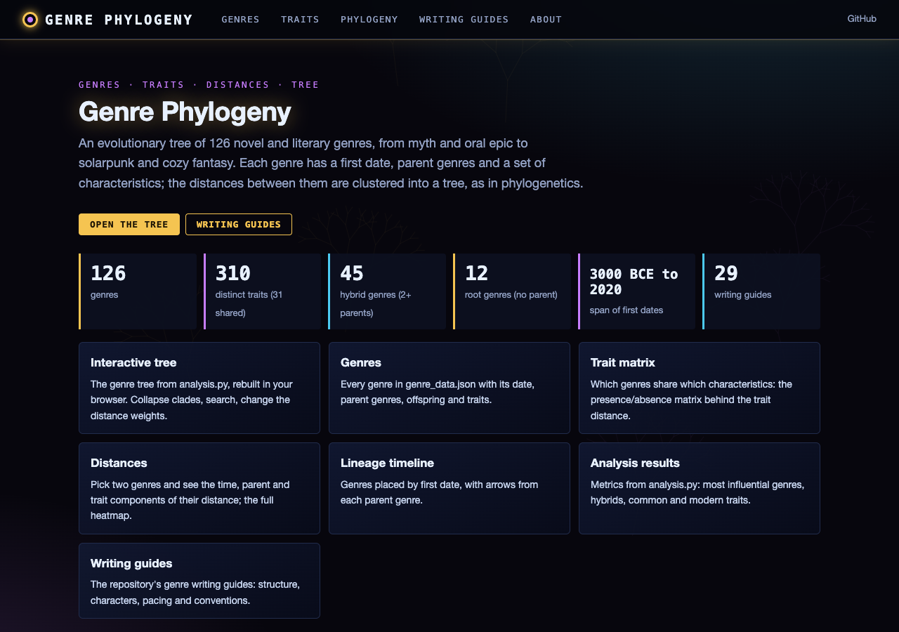
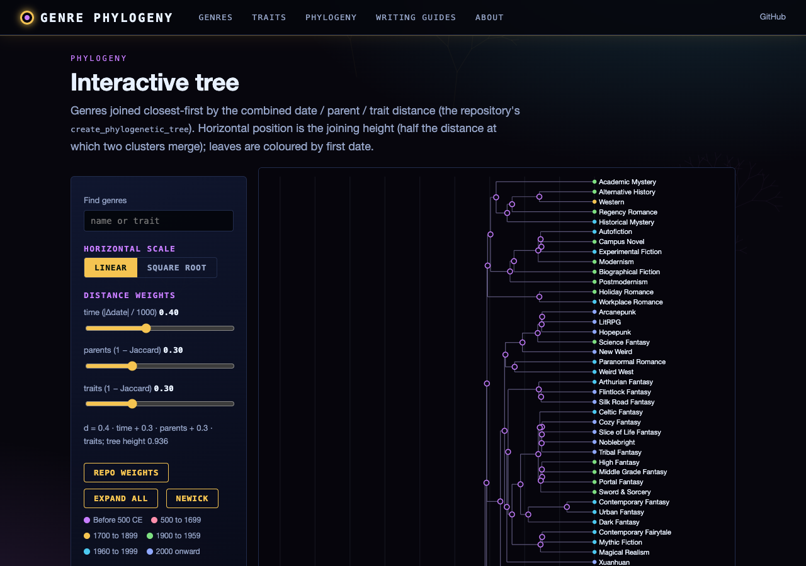
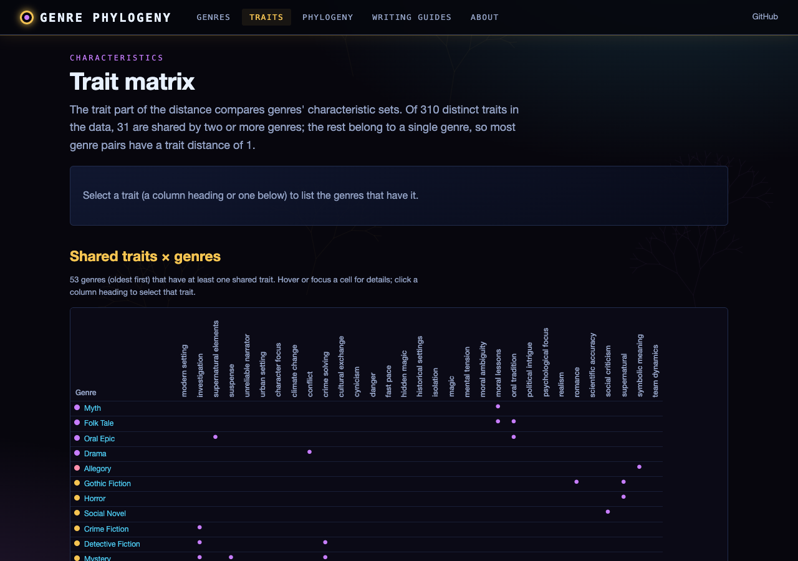
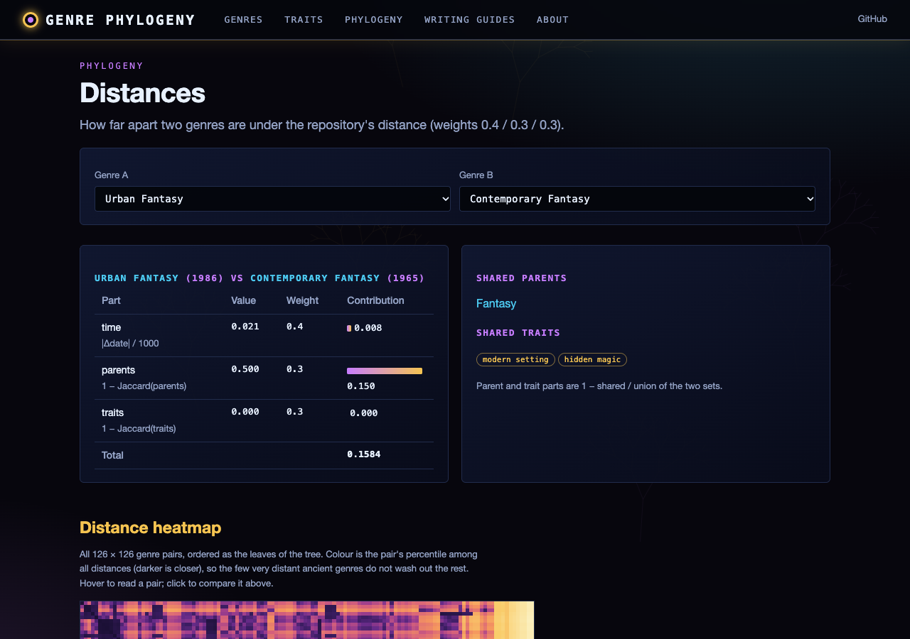
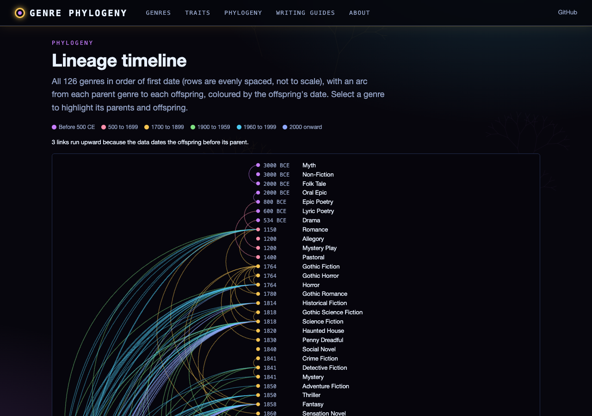
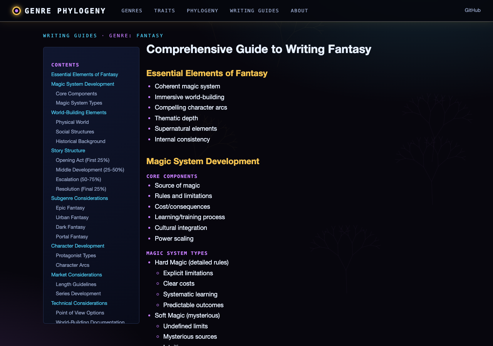

# Literary Genre Evolution Analyzer

A comprehensive Python tool for analyzing and visualizing the evolution of literary genres throughout history. This project combines network analysis, phylogenetic tree construction, and detailed genre characteristics to provide insights into how literary genres have emerged, evolved, and influenced each other over time.

## Overview

The Literary Genre Evolution Analyzer is a collaboration with Anthropic's Claude AI, aiming to create a data-driven understanding of literary genre evolution. The project maps over 120 genres from ancient forms to contemporary developments, analyzing their relationships, characteristics, and evolutionary patterns.

### Key Features

- **Timeline Visualization**: Creates a network graph showing genre evolution over time
- **Phylogenetic Analysis**: Generates evolutionary trees using UPGMA clustering
- **Characteristic Analysis**: Tracks the emergence and prevalence of genre features
- **Comprehensive Genre Database**: Contains detailed information about 120+ literary genres
- **Genre Writing Guides**: Includes detailed guides for writing in specific genres

## Visualizations

The project generates two main visualizations:

1. **Timeline Graph** (`genre_timeline.png`):
   - Shows chronological evolution of genres
   - Displays parent-child relationships
   - Includes time markers for historical context

2. **Phylogenetic Tree** (`genre_phylogeny.png`):
   - Illustrates genre clustering based on similarities
   - Shows evolutionary relationships
   - Highlights genre family groupings

## Web Interface

Explore the analysis in a browser: an interactive genre tree (collapse clades, search, change the distance weights),
the genre x trait matrix, pairwise distance breakdowns and heatmap, a lineage timeline, the analysis metrics and the
writing guides. `pip install -r requirements-web.txt && python run_web.py` (http://127.0.0.1:8170).
`python scripts/build_static.py` builds the GitHub Pages site (https://gddickinson.github.io/novel-genre-analysis/):
the distance and tree code is ported to JavaScript (`web/static/genre_engine.js`, tested against `analysis.py`), so
the static site rebuilds the tree in the browser.

| Home | Interactive tree | Trait matrix | Distances | Lineage timeline | Writing guide |
|---|---|---|---|---|---|
|  |  |  |  |  |  |

## Installation

```bash
git clone https://github.com/gddickinson/novel-genre-analysis.git
cd novel-genre-analysis
pip install -r requirements.txt
```

### Dependencies

- NetworkX
- Matplotlib
- NumPy
- Pandas
- SciPy

## Usage

Run the whole pipeline (saves `genre_timeline.png` and `genre_phylogeny.png`, prints the metrics):

```bash
python main.py
```

Or use the modules directly:

```python
from genre_database import load_genre_data
from analysis import create_phylogenetic_tree, analyze_genre_metrics, analyze_genre_characteristics

genres = load_genre_data()                      # genre_data.json
tree = create_phylogenetic_tree(genres)         # root Node of the average-linkage tree
metrics = analyze_genre_metrics(genres)
characteristics = analyze_genre_characteristics(genres)
```

Tests: `python -m pytest -q test_genre_evolution.py`.

## Project Structure

```
├── main.py                # CLI: runs the analysis and saves the plots
├── genre_database.py      # loads genre_data.json, validates parent links
├── genre_data.json        # the genre database (date, parents, characteristics)
├── analysis.py            # distance matrix, tree building, metrics
├── visualization.py       # timeline graph and tree plots
├── test_genre_evolution.py
├── genre-evolution.py     # original single-file version (reference only)
├── guides/                # writing guides for different genres
└── README.md
```

## Genre Analysis

The project analyzes genres across multiple dimensions:

- **Temporal Evolution**: Tracks when genres emerged and how they developed
- **Parent-Child Relationships**: Maps how genres influenced and spawned new genres
- **Characteristic Inheritance**: Analyzes how genre features are passed down and modified
- **Hybridization Patterns**: Studies how genres combine to form new subgenres

## Writing Guides

The repository includes detailed guides for writing in various genres, covering:
- Genre conventions and expectations
- Structural elements
- Character development
- Plot progression
- Market considerations

## Methodology

The analysis uses several computational approaches:

1. **Distance Calculation**:
   - Temporal distance (40% weight)
   - Parent similarity (30% weight)
   - Characteristic similarity (30% weight)

2. **Tree Construction**:
   - UPGMA (Unweighted Pair Group Method with Arithmetic Mean)
   - Hierarchical clustering
   - Distance-based phylogenetic analysis

## Contributing

Contributions are welcome! Please feel free to submit pull requests with:
- Additional genres
- Updated characteristics
- New writing guides
- Analysis improvements
- Visualization enhancements

## Contact

- George Dickinson (george.dickinson@gmail.com)
- GitHub: [@gddickinson](https://github.com/gddickinson)

## License

This project is licensed under the MIT License - see the LICENSE file for details.

## Acknowledgments

- Claude AI (Anthropic) for collaboration on analysis and guide creation
- NetworkX team for graph visualization capabilities
- Academic sources for genre history and characteristics

## Future Development

Planned improvements include:
- Interactive web visualization
- Additional genre guides
- Enhanced clustering algorithms
- Cultural influence mapping
- Geographic distribution analysis

